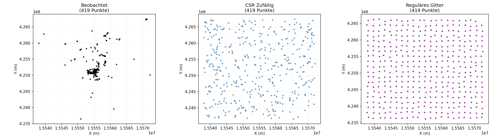
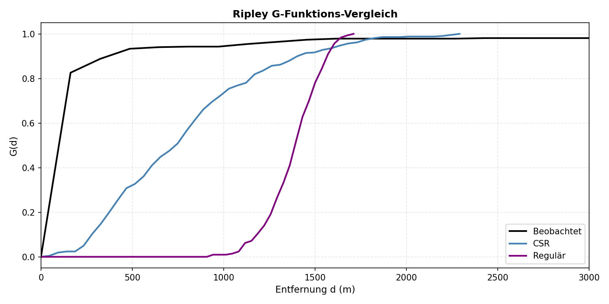
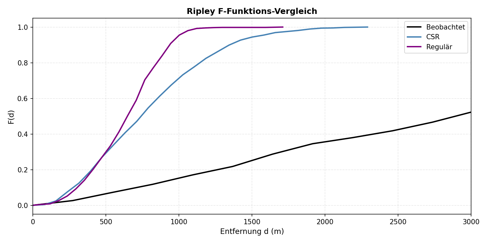
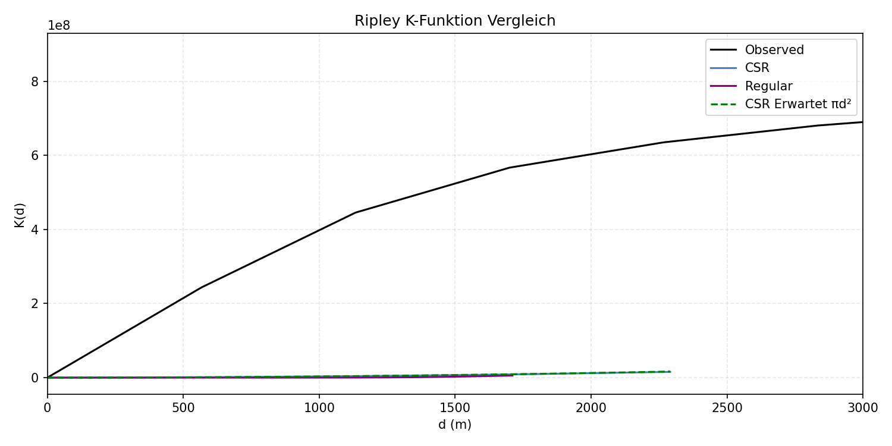
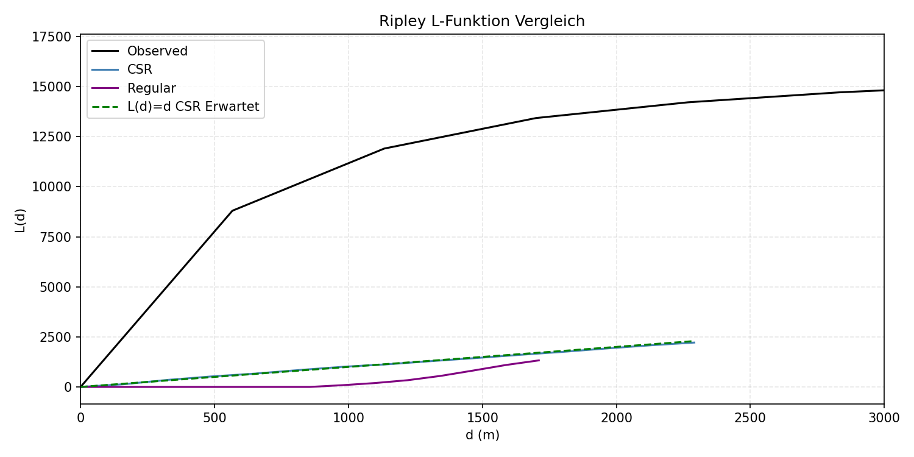

Geoinformatik 2 – GIS-Analyse
# Übung 8: Punktmusteranalyse mit Ripley Funktionen
Prof. Dr. Yu Feng

## Überblick

Diese Übung analysiert räumliche Punktmuster von Flickr-Fotos aus Tokio mithilfe des Nearest Neighbour Index (NNI) und der Ripley-Funktionen G, F, K und L. Wir vergleichen das beobachtete Muster mit zwei Referenzmustern: **CSR (Complete Spatial Randomness)** und **Reguläres Muster**.

## Notebook öffnen

Alternativ kann das [Studierenden-Notebook](Punktmuster2_Student.ipynb) lokal mit Jupyter geöffnet werden. Ergänzen Sie die markierten Aufgaben im Notebook.

Für die lokale Ausführung laden Sie die Daten wie in [Übung 7](../Uebung7/Punktmuster1_Student.ipynb) beschrieben herunter und bereiten die Umgebung vor. In Colab müssen `pointpats` und die benötigten Daten ebenfalls vorbereitet werden; das Notebook erwartet die Daten unter `../Uebung7/data/tokyo_clean.csv`.

## Visualisierungen

### Punktmustervergleich

Drei Mustertypen mit jeweils 419 Punkten: Beobachtete Flickr-Fotos zeigen deutliche Clusterung, CSR als zufällige Referenz, und reguläres Gitter als gleichmäßige Verteilung.

### G-Funktion: Nächster-Nachbar-Abstände

Beobachtet steigt schnell an (viele kurze Abstände = Clusterung), Regulär steigt langsam an (große Mindestabstände = gleichmäßig), CSR liegt dazwischen.

### F-Funktion: Leerraum-Analyse

Beobachtet steigt langsam an (große Leerräume zwischen Clustern), Regulär steigt schnell an (keine Lücken), CSR liegt dazwischen.

### K-Funktion: Paardichte

Beobachtet liegt über der Erwartung πd² (mehr Nachbarn = Clusterung), Regulär liegt darunter (weniger Paare = gleichmäßig), CSR entspricht der Erwartung.

### L-Funktion: Normalisierte K-Funktion

L(d) = √(K(d)/π). Beobachtet über der Linie L(d)=d (Clusterung), Regulär darunter (Regularität), CSR nahe der Linie (Zufälligkeit).

## Referenzen

- [Geographic Data Science with Python](https://geographicdata.science/book/notebooks/08_point_pattern_analysis.html)
- [pointpats Dokumentation](https://pysal.org/notebooks/explore/pointpats/distance_statistics.html)

